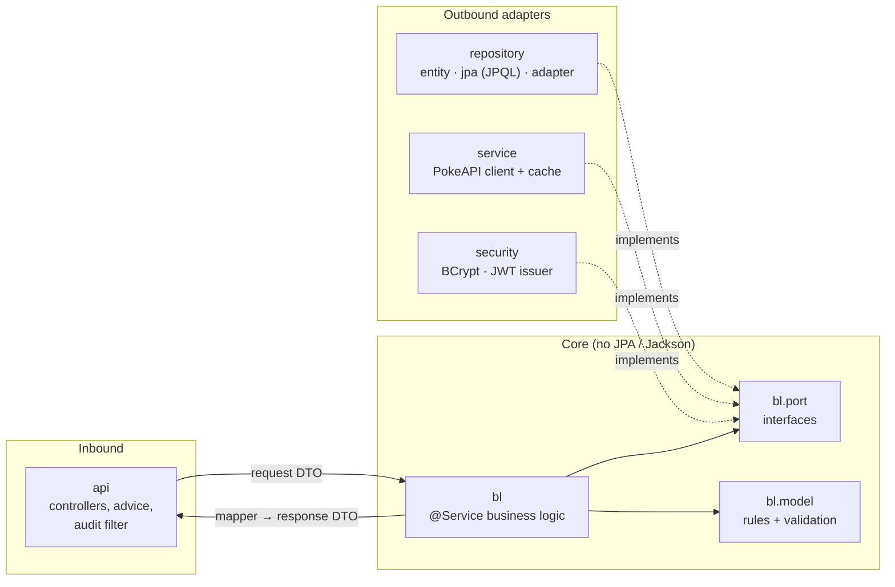

# PokeBallast

A full-stack app on top of [PokeAPI](https://pokeapi.co/docs/v2). You can browse Pokémon, open their full details, copy them into our own relational database, and edit the extra fields that PokeAPI does not have: localized names, regions and internal tags. It includes registration and JWT login, with public, signed-in and admin routes.

| Part | Stack | Folder |
|---|---|---|
| REST API | Java 21, Spring Boot 4.1, Spring Security (JWT resource server), Spring Data JPA, Flyway, Caffeine, springdoc | [`pokeballast/`](pokeballast/) |
| Web UI | React 19, TypeScript, Vite, React Router, TanStack Query | [`react-pokeballast/`](react-pokeballast/) |
| Database | PostgreSQL 17 (Docker); H2 in PostgreSQL mode for zero-setup runs and tests | [`pokeballast/database/`](pokeballast/database/) |
| GenAI exercise | Prompt, generated Task Management API and how the output was validated | [`generated-code-ai/`](generated-code-ai/) |

---

## 1. Quick start

### Docker: the whole stack

```bash
docker compose up --build
```

| URL | What |
|---|---|
| http://localhost:3000 | Web UI |
| https://localhost:3443 | Web UI over HTTPS (self-signed certificate generated at startup: accept the browser warning) |
| http://localhost:8080/swagger-ui.html | Interactive API documentation |
| http://localhost:8080/actuator/health | Health check |

The demo values in `docker-compose.yml` can be overridden: `JWT_SECRET=$(openssl rand -base64 48) DB_PASSWORD=... docker compose up --build`.

### Local development (no Docker)

Requirements: **JDK 21** and **Node.js 22+** (developed with 24 LTS).

```bash
# terminal 1: API on :8080, in-memory H2 with the demo data
cd pokeballast && ./mvnw spring-boot:run

# terminal 2: UI on :5173 (Vite proxies /api to :8080)
cd react-pokeballast && npm ci && npm run dev
```

To run the API against your own PostgreSQL, copy `pokeballast/config/application-local.example.yaml` to `application-local.yaml` (it is git-ignored), set your credentials and run with `SPRING_PROFILES_ACTIVE=local`.

### Demo data (loaded automatically)

| User | Password | Role | Can |
|---|---|---|---|
| `ash` | `Pikachu123` | TRAINER | browse, import, re-sync, edit |
| `admin` | `Admin1234` | ADMIN | everything above + delete |

Eight Pokémon are preloaded with localized names, region and tags. The data was taken from PokeAPI and stored in a seed script, so the collection works offline. New accounts can be created at `/register`; they always get the TRAINER role.

### Tests

```bash
cd pokeballast && ./mvnw clean verify       # 174 tests, JaCoCo report (98% line coverage), ArchUnit rules
cd react-pokeballast && npm test           # 44 tests (Vitest + Testing Library + MSW)
cd react-pokeballast && npm run lint && npm run build
```

---

## 2. User stories → API → UI

| Story | API | UI |
|---|---|---|
| **US01** Paginated list with sprite, category, mass and skills; cached | `GET /api/v1/pokemon?page&size` | `/` grid, page kept in the URL |
| **US02** Detail: image, stats, description, evolution lineage | `GET /api/v1/pokemon/{idOrName}` | `/pokemon/:idOrName`, with stat bars and the evolution **tree** (Eevee has 8 branches) |
| **US03** Copy into our DB and add proprietary fields | `POST /api/v1/local-pokemon`, `POST /{id}/refresh`, `GET` list (`name`, `tag`) and `GET /{id}` | "Save to collection" button, import form, re-sync, filters |
| **US04** Update local records, with 404/400 and defensive logic | `PUT /api/v1/local-pokemon/{id}` (optimistic locking), `DELETE /{id}` | `/collection/:id/edit`, admin delete with confirmation |
| **F05** Registration and authentication | `POST /api/v1/auth/register`, `POST /login`, `GET /me` | `/register`, `/login`, role-aware UI |

How the story wording is read:
* **Category** is the Pokédex category (`genus`, e.g. "Seed Pokémon").
* **Skills** are abilities (moves can be 100+ per Pokémon).
* **Mass** is shown in kg, but stored in PokeAPI's hectograms so nothing is lost.
* **Proprietary fields** are `localizedName`, `region` and `tags`. They are the only editable fields: the replicated data belongs to PokeAPI and is refreshed on re-sync.

| Access | Anonymous | TRAINER | ADMIN |
|---|---|---|---|
| Browse, read the collection, register, login | ✅ | ✅ | ✅ |
| Import, re-sync, update | 401 | ✅ | ✅ |
| Delete | 401 | 403 | ✅ |

---

## 3. Architecture

### Backend: business logic independent of the API and of data access



Packages under `com.ballastlane.pokeproject`:

| Package | Contains |
|---|---|
| `api` | Controllers |
| `api.advice` | Error mapping |
| `api.filter` | Audit headers |
| `bl` | Business logic (`@Service`) |
| `bl.model` | Business models and rules |
| `bl.port` | Interfaces the business logic needs |
| `dto` | API contract (with `dto.pokeapi` holding the PokeAPI wire format) |
| `mapper` | Conversions between types |
| `repository` | `entity`, `jpa` (JPQL) and `adapter` |
| `service` | PokeAPI client |
| `security` | BCrypt and JWT adapters |
| `exceptions` | `BallastException` and the code catalog |
| `util` | Helpers |
| `config` | Spring configuration |

The dependency rules are **enforced by ArchUnit**. For example, `bl` cannot import `api`, `dto`, `repository` or JPA, and the PokeAPI DTOs cannot leave `service`/`mapper`. The full table is in [`pokeballast/CLAUDE.md`](pokeballast/CLAUDE.md), and the data model in [`pokeballast/database/model/data-model.md`](pokeballast/database/model/data-model.md).

### Frontend: features + server-state cache

```
react-pokeballast/src
├── api/        the only code that knows HTTP: BallastResponse unwrapping, ApiError, typed endpoints, query keys
├── auth/       session (JWT) provider, useAuth, RequireAuth (roles)
├── features/   catalog (US01/US02) · collection (US03/US04) · auth (F05). Features never import each other
├── shared/     layout, pagination, status views, format helpers
└── styles/     design tokens + global styles (CSS Modules per component)
```

State is split by type:

| State | Where |
|---|---|
| Server data | TanStack Query (cache, cancellation, `keepPreviousData` paging, invalidation after mutations) |
| Paging and filters | The URL |
| Session | A small React Context |
| Forms | Local state in the component |

---

## 4. API conventions

**Every response uses the same envelope:**

```json
{ "responseCode": "0000", "response": { "...": "..." }, "errorDetail": null }
```

The only exception is a successful `DELETE`, which returns `204 No Content` with no body.

| Code | HTTP | Meaning |
|---|---|---|
| `0000` | 200/201 | Success |
| `1000`–`1007` | 400 (405/415) | Invalid request; `response` holds the per-field messages |
| `2000`–`2002` | 404 | Route, Pokémon or local record not found |
| `3001`–`3004` | 409 | Already imported, stale version, concurrent modification, username taken |
| `4001` / `4002` / `4003` | 401 / 401 / 403 | Missing or invalid token / bad credentials / role not allowed |
| `5001` | 503 | PokeAPI unavailable or timing out |
| `9999` | 500 | Unexpected error (no internals revealed) |

* **Auth:** `Authorization: Bearer <token>` from `POST /api/v1/auth/login`. HS256 JWT valid for 2 hours, with the role in the `roles` claim. `@PreAuthorize` is declared on every endpoint.
* **Audit headers**, all optional: `X-Forwarded-For`, `x-user`, `x-latitude`, `x-longitude`, `x-channel`. They are captured once per request and attached to the log lines of that request. `x-user` is never used for authorization, and the headers are not forwarded to external services.
* **Logs** are prefixed by layer (`[REQUEST]`, `[BL]`, `[SERVICE]`, `[DB]`, `[UTIL]`) and never contain passwords, hashes or tokens.
* Full reference: **Swagger UI** (`/swagger-ui.html`). Every operation states its user story, validations, role and every response code.

---

## 5. Security

| Concern | How it is handled |
|---|---|
| **Traffic encryption** | TLS terminates at nginx (`https://localhost:3443`, TLS 1.2/1.3, HSTS). The certificate is never in the repo or the image: it is generated at container start (self-signed, local only) unless a real one is mounted at `/etc/nginx/certs`. The nginx → API hop stays inside the Docker network. The API honours `X-Forwarded-Proto/Host`, so the URLs it builds use `https`. |
| **Password storage** | Only a **BCrypt hash, cost 12** (2^12 rounds, about 0.3s), with a random salt per password. It is one-way: there is nothing to decrypt. Someone with a database dump can only try guesses one by one, and each costs about 0.3s per password. No rainbow tables (salted), and equal passwords look different. The raw password is never stored, logged or returned. Tests check the format, the cost, the salt and what is in the table. |
| **Tokens** | HS256 JWT signed with `JWT_SECRET` (at least 32 bytes, from the environment), expiring after 2h; roles in the `roles` claim; validated by Spring's resource server. |
| **Authorization** | `@PreAuthorize` on every endpoint; self-registration always creates TRAINER. |
| **User enumeration** | Same message and similar timing for an unknown user and a wrong password. |
| **Input** | Pokémon identifiers validated before reaching an upstream URL; LIKE wildcards escaped; unknown JSON fields rejected; log values sanitized against log injection. |

## 6. Key design decisions

| Decision | Why |
|---|---|
| Business rules live in `bl.model` (e.g. `Customization`, `PokemonIdentifier`, `UserCredentials`) | One place for validation, independent of HTTP and JPA. Bean Validation only checks the request shape. |
| Controllers are entry points only; the BL orchestrates and maps to the response DTOs | Thin controllers that only translate HTTP. All the logic, including the mapping, sits in one testable layer. |
| Each service method = one external call; the BL combines them (e.g. US01: page + pokemon + species per item, concurrently) | Services stay simple, cacheable and swappable; the composition rules are business decisions and are unit-tested in the BL. |
| Ports and adapters (`bl.port`) | The business logic can be unit-tested in milliseconds with mocks; PokeAPI and JPA can be swapped. |
| Separate JPA entities and business models | JPA needs mutable classes; the business models are immutable records. |
| Only the proprietary fields are editable | The replicated data is mastered by PokeAPI and would be overwritten by a re-sync. |
| Optimistic locking (`version` in the PUT + `@Version`) | Prevents lost updates: a stale copy gets 409 instead of silently overwriting. |
| Unique constraints in the database (`poke_api_id`, `username`) | The business checks give friendly errors; the DB is the real guarantee under concurrency (also 409). |
| PokeAPI list enrichment fanned out on virtual threads + Caffeine cache + timeouts | PokeAPI's list only returns names: US01 needs 2 extra calls per item. A cached page answers in milliseconds, and a slow upstream becomes 503, never a hang. |
| Resilience4j below the cache: rate limiter, bulkhead, retry (transient only), circuit breaker | We never flood PokeAPI (at most 50 calls/s and 20 concurrent), transient errors are absorbed, a dead upstream fails fast with 503 instead of piling up requests, and a 404 is never retried. |
| Spring's OAuth2 resource server for JWT | No hand-written token filter. The secret must be at least 32 bytes, or the app refuses to start. |
| Same message and similar timing for unknown user and wrong password | Prevents user enumeration. |
| Flyway owns the schema (`database/scripts`); seed in a repeatable, idempotent script | Reviewable migrations; tests run on the schema only, while the app starts with demo data. |
| Frontend checks "already saved?" before importing | An expected 409 would otherwise appear as a red error in the browser console. |
| JWT stored in `localStorage` | Survives reloads, which keeps the demo simple. Trade-off: an XSS bug could read it; production would use an httpOnly cookie with CSRF protection. |
| nginx (Docker) / Vite (dev) proxy `/api` | The browser talks to a single origin, so no CORS configuration is needed. |

---

## 7. Quality evidence

* **Backend:** 174 tests and 98% line coverage. They cover:
  * Business rules and `bl` with mocks.
  * Controllers with the real security config (`@WebMvcTest`).
  * JPQL queries on the real Flyway schema (`@DataJpaTest`).
  * The PokeAPI client against recorded payloads (`MockRestServiceServer`), plus a test proving the cache is hit.
  * End-to-end flows with real JWTs.
  * ArchUnit dependency rules.
* **Frontend:** 44 tests written from the user's point of view, with MSW returning the real `BallastResponse` contract.
* **Real browser:** the whole flow (browse → detail → sign in → save → filter → edit → re-sync → register → admin delete) was checked in Chromium on desktop and at 390px, against the Vite dev server and against the Docker stack. There were **no console warnings or errors** and no horizontal overflow.
* **Databases:** the API was verified against PostgreSQL 11 (local) and PostgreSQL 17 (Docker).

## 8. Known limitations / next steps

* No refresh tokens or token revocation; tokens are short-lived (2h).
* No rate limiting of our own API, e.g. `/auth/login` per IP (Resilience4j or Bucket4j). BCrypt's cost already makes each guess slow.
* The self-signed certificate is for local use only. In production the proxy needs a trusted certificate (e.g. Let's Encrypt), HTTP should redirect to HTTPS, and only the proxy should be exposed (not `:8080`).
* The persistence tests run on H2 in PostgreSQL mode. Testcontainers would run them on a real PostgreSQL in CI.
* No CI pipeline yet (`./mvnw verify`, `npm ci && npm run lint && npm test && npm run build`, `docker compose build`).
