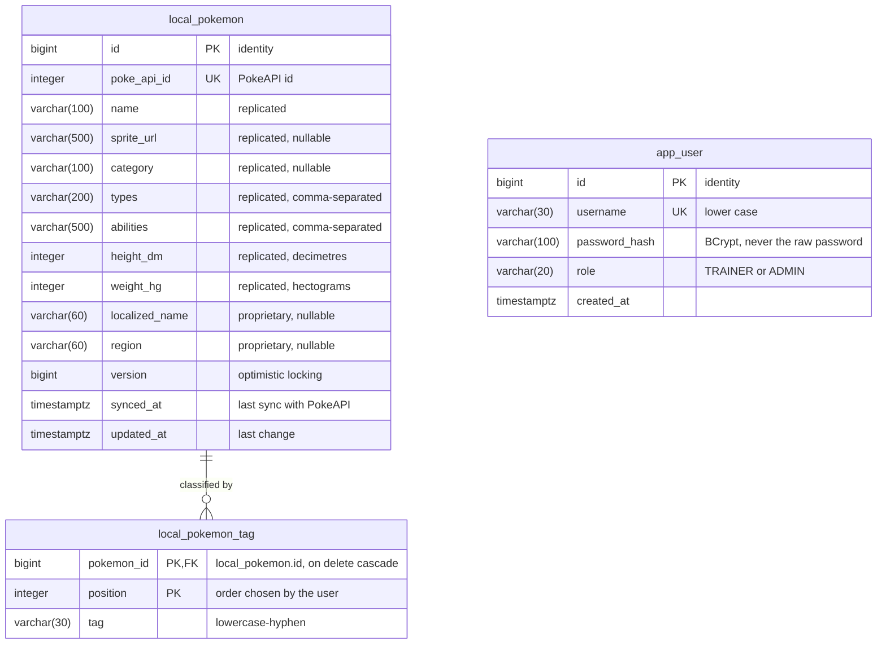

# PokeBallast data model

Relational model for PostgreSQL (H2 in PostgreSQL mode for local runs and tests).

| Table | Purpose | Status | Script |
|---|---|---|---|
| `local_pokemon` | Pokémon replicated from PokeAPI plus our proprietary fields (primary entity) | Implemented | `V1__create_local_pokemon.sql` |
| `local_pokemon_tag` | Internal classification tags of each local Pokémon | Implemented | `V1__create_local_pokemon.sql` |
| `app_user` | Registered users and their role (secondary collection: user management) | Implemented | `V2__create_app_user.sql` |

`app_user` has no relationship with the Pokémon tables: the collection is shared by all users. Adding an owner (for example, `local_pokemon.created_by`) would be a new script.

---

## `local_pokemon`

| Column | Type | Null | Notes |
|---|---|---|---|
| `id` | `bigint` identity | no | Primary key. Our own id, independent of PokeAPI. |
| `poke_api_id` | `integer` | no | **Unique** (`uk_local_pokemon_poke_api_id`). Each PokeAPI Pokémon is stored once; the constraint is the real guarantee when two imports race. |
| `name` | `varchar(100)` | no | Replicated. |
| `sprite_url` | `varchar(500)` | yes | Replicated. |
| `category` | `varchar(100)` | yes | Replicated; PokeAPI genus, e.g. "Seed Pokémon". |
| `types` | `varchar(200)` | no | Replicated, comma-separated (e.g. `grass,poison`). |
| `abilities` | `varchar(500)` | no | Replicated, comma-separated. |
| `height_dm` | `integer` | no | Replicated in PokeAPI units (decimetres); `check >= 0`. |
| `weight_hg` | `integer` | no | Replicated in PokeAPI units (hectograms); `check >= 0`. |
| `localized_name` | `varchar(60)` | yes | **Proprietary**: localized name. |
| `region` | `varchar(60)` | yes | **Proprietary**: geographical metadata. |
| `version` | `bigint` | no | Optimistic locking (`@Version`); default 0. |
| `synced_at` | `timestamptz` | no | Last time the replicated data came from PokeAPI. |
| `updated_at` | `timestamptz` | no | Last change of any field. |

## `local_pokemon_tag`

| Column | Type | Null | Notes |
|---|---|---|---|
| `pokemon_id` | `bigint` | no | FK to `local_pokemon.id`, **on delete cascade**. |
| `position` | `integer` | no | Keeps the order in which the user entered the tags. |
| `tag` | `varchar(30)` | no | Already normalized by the business logic (lower case, `[a-z0-9]+(-[a-z0-9]+)*`). |

- Primary key `(pokemon_id, position)`.
- Index `ix_local_pokemon_tag_tag (tag)`, for the tag filter.

## `app_user`

| Column | Type | Null | Notes |
|---|---|---|---|
| `id` | `bigint` identity | no | Primary key. |
| `username` | `varchar(30)` | no | **Unique** (`uk_app_user_username`). Stored in lower case so uniqueness is case-insensitive. |
| `password_hash` | `varchar(100)` | no | BCrypt hash (60 chars; room for algorithm changes). |
| `role` | `varchar(20)` | no | `TRAINER` or `ADMIN`; `check (role in ('TRAINER','ADMIN'))`. |
| `created_at` | `timestamptz` | no | Default `current_timestamp`. |

The table is named `app_user` because `user` is a reserved word in PostgreSQL.

## Demo data

`scripts/seed/R__seed_demo_data.sql` (repeatable, idempotent) inserts:
- Two users: `ash` (TRAINER) and `admin` (ADMIN), with BCrypt hashes. The passwords are documented in the README.
- Eight Pokémon with their proprietary fields (localized name, region, tags).

The values are real PokeAPI data, so the app is usable offline on first start.

---

## Design decisions

| Decision | Why |
|---|---|
| Own primary key + unique `poke_api_id` | The local record has its own identity, and PokeAPI ids can never be duplicated, even under concurrency. |
| Measurements stored in PokeAPI units | No precision lost; kg and m are computed when presenting. |
| `types` / `abilities` as delimited text | They are replicated, read-only and never filtered on, so a child table would only add joins. |
| Tags in a child table, indexed | Tags are filtered on (`tag = ?`) and belong to our domain. |
| `on delete cascade` on tags | Deleting a Pokémon cannot leave orphan tags, whatever deletes it. |
| `version` column | Prevents lost updates when two users edit the same record (409 instead of overwriting). |
| `timestamptz` | Instants are stored with their offset; the API exposes UTC. |
| Check constraints on measurements and role | The database rejects impossible data even if a bug bypasses the business rules. |
